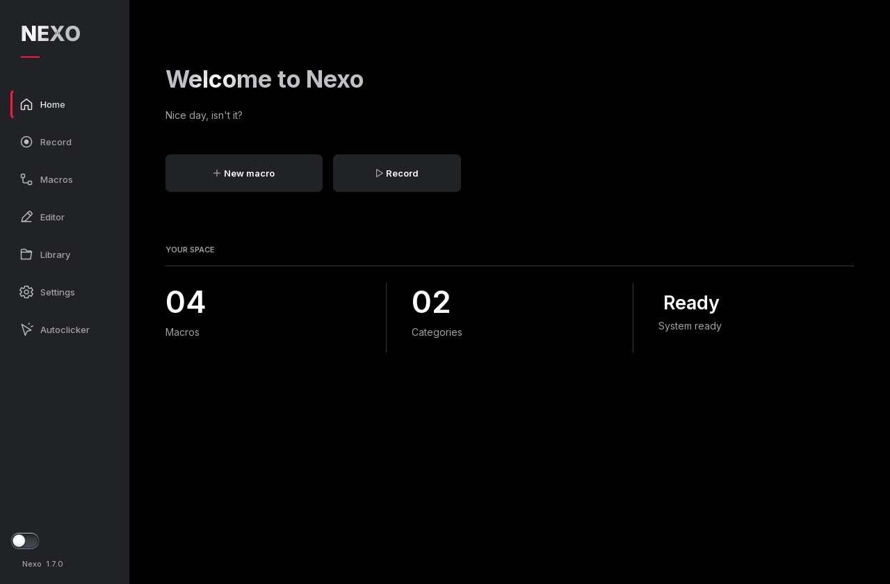

# Nexo

Record and repeat keyboard and mouse actions on Windows. Nexo includes an autoclicker and a sequence editor, so you can adjust individual steps without recording everything again.



## Download

Get the latest build from [Releases](https://github.com/Astonto/Nexo/releases/latest).

- **Installer x64 (-setup.exe):** installs Nexo, adds it to Windows Apps and creates a Start menu shortcut. A desktop shortcut is optional.
- **Portable x64 (.zip):** extract the folder and open `Nexo.exe`.
- **Standalone x64 (.exe):** the same application without the ZIP. No installation needed.

Requires 64-bit Windows 10 or 11. You do not need Python to run the downloads.

There is no 32-bit build: the PySide6 version used by Nexo does not provide official Windows x86 packages.

## Features

- Record keyboard and mouse input, then edit the timing of each action.
- Organize macros by category and assign global shortcuts.
- Run a sequence once, hold a trigger to repeat, or press again to stop.
- Repeat clicks or keystrokes with intervals starting at 1 ms.
- Ignore Ctrl, Alt, Shift or Windows when using the keyboard repeater's hold trigger.
- Choose a light or dark theme and your own accent color.
- Use the full interface in English or Spanish.

The interval setting is not a guarantee of exact timing. Key press duration, Windows scheduling and the target application also affect the actual rate.

## Getting started

1. Create a macro and open **Record**.
2. Select the window to record, or leave the target set to the entire screen.
3. Record your actions, stop capture and save.
4. Open **Macros** and choose how to play it. Use **Configure** to assign a shortcut.

Recording, playback, autoclicker and emergency stop shortcuts can be changed in **Settings → Shortcuts**. Check them before starting.

The switch above the version number locks all automation. Turning it on stops the current task.

To change the language, open **Settings → General**, choose **English** or **Español**, and press **Save preferences**. Quit Nexo and open it again to apply the change. Existing Spanish settings are kept; new installations start in English.

## Target windows

- **Background:** sends Windows messages to the selected window without activating it. Some applications ignore these messages.
- **Focused:** runs while the selected window is active. Playback stops if it loses focus.
- **Activate window:** tries to restore the target and bring it to the front before running. If Windows refuses activation, no input is sent.

Windows accepting a message does not mean the application processed it. Background mode does not work with every program or game.

## Your data

The installed edition saves settings and macros in `%LOCALAPPDATA%\Nexo`, separately for each Windows user. Uninstalling Nexo keeps this folder.

The installer defaults to your user account without requiring administrator rights. You can also choose to install for all users, which requires administrator approval. The default application locations are `%LOCALAPPDATA%\Programs\Nexo` for the current user and `C:\Program Files\Nexo` for all users.

The portable edition creates `Nexo-data` next to the executable. If that location is not writable, it uses `%LOCALAPPDATA%\Nexo`. Keep your data folder when updating; quit Nexo before replacing files or running the installer.

Installing does not move or delete an existing portable data folder. To keep using its macros, select that folder's `macros` subfolder in **Settings → General → Macro folder**. You can also import individual JSON macros from the Library.

By default, the X hides Nexo in the system tray. Use **Quit Nexo** to close it completely. Opening the executable again shows the existing instance.

## Run from source

Requires Windows and 64-bit Python 3.12 or newer.

```powershell
py -3 -m venv .venv
.venv\Scripts\python -m pip install -r requirements-dev.txt
.venv\Scripts\python main.py
```

Run the tests:

```powershell
.venv\Scripts\python -m pytest -q
```

Run `build.bat` to build and check the executable. The result is `dist/Nexo.exe`.

To build the installer, install [Inno Setup 6](https://jrsoftware.org/isdl.php), then run:

```powershell
.venv\Scripts\python tools\build_installer.py
```

Use `--compiler` if `ISCC.exe` is in a custom location. The installer is written to `dist/release`. `installer/nexo-installed` tells the installed application to use its user data folder; portable downloads do not include this marker.

## License

Nexo's own code is released under the [MIT license](LICENSE). You can use, modify and share it while keeping the copyright and license notice.

Built with Python, PySide6, pynput and comtypes. Dependency credits and licenses are listed in [THIRD_PARTY.md](THIRD_PARTY.md) and `resources/licenses`.
