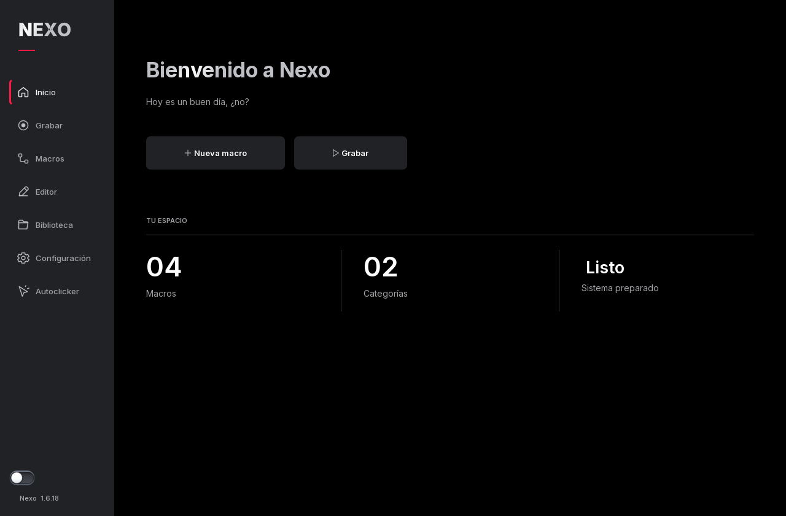

# Nexo

Nexo sirve para grabar y repetir acciones de teclado y ratón en Windows. También incluye un autoclicker y un editor para ajustar cada paso sin tener que grabar todo de nuevo.



## Descargar

Las descargas están en [Releases](https://github.com/Astonto/Nexo/releases).

- **Portable x64 (.zip):** descomprime la carpeta y abre `Nexo.exe`.
- **Ejecutable x64 (.exe):** es la misma aplicación, sin el ZIP. No necesita instalación.

Funciona en Windows 10 y 11 de 64 bits. No hace falta instalar Python.

Por ahora no hay versión de 32 bits: la versión de PySide6 que usa Nexo no tiene paquetes oficiales para Windows x86.

## Qué puedes hacer

- Grabar teclado y ratón, y editar los tiempos de cada acción.
- Organizar macros por categorías y asignarles un atajo.
- Reproducir una vez, repetir o mantener pulsado un activador.
- Repetir clics o teclas con intervalos desde 1 ms.
- Ignorar Ctrl, Alt, Shift o Windows al usar el activador del repetidor de teclado.
- Cambiar entre tema claro y oscuro, y elegir el color de acento.

El intervalo configurado no garantiza una frecuencia exacta: también cuentan la duración de la pulsación, Windows y la aplicación que recibe la entrada.

## Uso rápido

1. Crea una macro y entra en **Grabar**.
2. Selecciona la ventana que quieres grabar o deja toda la pantalla.
3. Graba las acciones, detén la captura y guarda.
4. En **Macros**, elige cómo ejecutarla. Puedes cambiar el atajo desde **Configurar**.

Los controles de grabación, reproducción, autoclicker y parada de emergencia se pueden cambiar en **Configuración → Atajos**. Conviene revisar esa lista antes de empezar.

El interruptor sobre la versión bloquea toda la automatización. Al activarlo, se detiene lo que esté ejecutándose.

## Ventana de destino

- **Segundo plano:** envía mensajes de Windows a la ventana elegida sin activarla. Algunas aplicaciones los ignoran.
- **Con foco:** ejecuta mientras la ventana elegida está activa. Si pierde el foco, se detiene.
- **Activar ventana:** intenta restaurar y traer el destino al frente antes de ejecutar. Si Windows no permite activarlo, no envía entradas.

Que Windows acepte un mensaje no significa que la aplicación lo haya procesado. El modo de segundo plano no es compatible con todos los programas o juegos.

## Dónde se guarda todo

Nexo crea una carpeta `Nexo-data` junto al ejecutable. Ahí guarda los ajustes y las macros. Para actualizar, cierra Nexo y reemplaza solamente el ejecutable; conserva esa carpeta. Si la ubicación no permite escritura, utiliza `%LOCALAPPDATA%\Nexo`.

La X oculta la ventana en la bandeja de forma predeterminada. Para cerrar la aplicación por completo, usa **Salir de Nexo**. Abrir el ejecutable otra vez muestra la instancia que ya estaba abierta.

## Ejecutar desde el código

Necesitas Windows y Python 3.12 o superior, de 64 bits.

```powershell
py -3 -m venv .venv
.venv\Scripts\python -m pip install -r requirements-dev.txt
.venv\Scripts\python main.py
```

Para ejecutar las pruebas:

```powershell
.venv\Scripts\python -m pytest -q
```

Para generar y comprobar el ejecutable, ejecuta `build.bat`. El resultado queda en `dist/Nexo.exe`.

## Dependencias

Hecho con Python, PySide6, pynput y comtypes. Los créditos y licencias están en [THIRD_PARTY.md](THIRD_PARTY.md) y `resources/licenses`.
